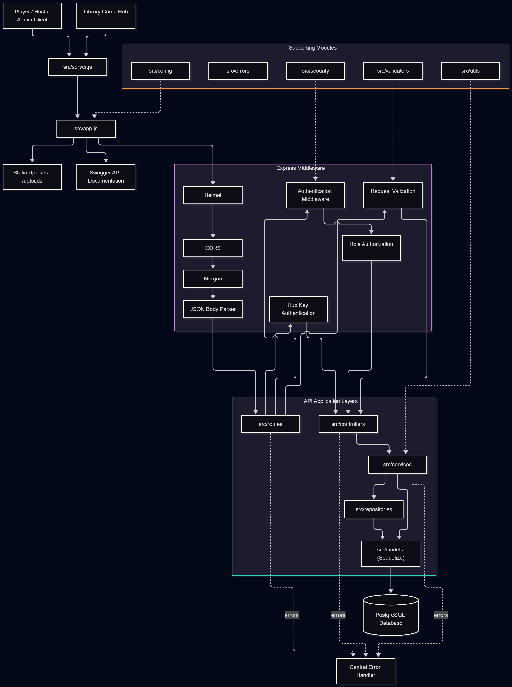
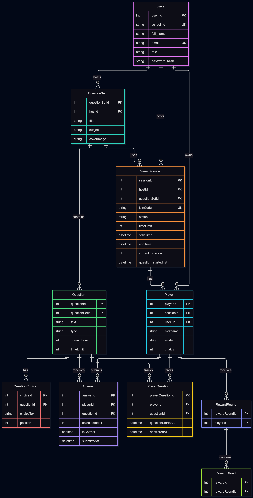

# Technical specification: Shinobi Quiz Battle API

Version 1.0.0, SE1 final build. Developer: Lourens L. Gacias (`devlou-rens`), BSCS 3-2. Group: Team 2.

## 1. Purpose and scope

Shinobi Quiz Battle is a responsive educational quiz game inspired by Naruto Shippuden. Players join a hosted game using a Game PIN, answer questions, and earn or lose Chakra through the quiz and reward system. Hosts create and manage game sessions, while administrators manage and monitor the system.

The Library Game Hub retrieves player results through a protected API endpoint using the `X-Hub-Key` header. This allows the Hub to access game results for its library services without making the results endpoint publicly accessible.

SE1 covers the backend API, including authentication, authorization, game sessions, question management, player participation, answer processing, rewards, results, database operations, and API documentation. SE2 will add the frontend interface for players, hosts, and administrators.

## 2. Architecture

A request first enters the Express application and passes through its configured middleware. Helmet adds security-related HTTP headers, CORS checks browser origins, Morgan logs requests outside test mode, and Express parses JSON request bodies. Uploaded images are made accessible through the `/uploads` static path.

Requests then enter the `/api/v1` routes. Route middleware handles authentication, authorization, and validation where required. Controllers handle HTTP requests and responses and call the appropriate services. Services implement application and game rules, repositories handle database queries, and Sequelize models define database tables and relationships. Errors are passed to the central error handler.

| Layer | Folder | Responsibility | Never |
|---|---|---|---|
| Routes | `src/routes` | Defines API endpoints and connects middleware to controllers. | Contains game business rules or direct database queries. |
| Validators | `src/validators` | Checks request data and rejects invalid input. | Saves data or decides game results. |
| Controllers | `src/controllers` | Handles HTTP requests, calls services, and sends responses. | Contains complex game rules or direct database queries. |
| Services | `src/services` | Implements application rules, game logic, authorization decisions, and workflows. | Handles Express response formatting or duplicates repository database-query logic. |
| Repositories | `src/repositories` | Performs database queries and retrieves or stores records. | Handles HTTP responses or decides route permissions. |
| Models | `src/models` | Defines Sequelize tables, columns, and relationships. | Handles HTTP requests or complete application workflows. |

## 3. Data

The PostgreSQL database contains 10 application tables: `Answer`, `GameSession`, `Player`, `PlayerQuestion`, `Question`, `QuestionChoice`, `QuestionSet`, `RewardObject`, `RewardRound`, and `users`.

See the [data dictionary](datadictionary.md) for the generated table and column reference.

The database enforces primary keys, foreign keys, and unique constraints to protect data relationships and prevent duplicate records. Examples include unique player nicknames within a game, unique player membership in a game, and unique school IDs and email addresses.

The application maps selected database constraint violations through `src/errors/constraint-map.js`. For example:

- Duplicate nicknames return `409 NICKNAME_TAKEN`.
- Duplicate player membership returns `409 PLAYER_ALREADY_JOINED`.
- Duplicate school IDs return `409 SCHOOL_ID_EXISTS`.
- Duplicate email addresses return `409 EMAIL_EXISTS`.

## 4. Security

| Concern | Decision |
|---|---|
| Passwords | Passwords are hashed using `bcryptjs` before storage. The default cost factor is 10 rounds and can be configured through `BCRYPT_ROUNDS`. Login also performs a dummy hash comparison when an account is not found to reduce account-enumeration through response timing. |
| Login and tokens | Users log in using their school ID and password. Successful login returns a JWT Bearer token signed with HS256. Tokens contain the user ID and role and expire after one hour by default. The expiration is configurable through `JWT_EXPIRES_IN`. |
| Roles | Public registration always creates a `PLAYER` account. Protected routes use role-based middleware to restrict access. Requests without valid authentication receive HTTP 401, while authenticated users without permission receive HTTP 403. |
| Input | Route validation uses `express-validator`. Invalid requests stop before reaching the controller and return HTTP 400 with the `VALIDATION_FAILED` error code. |
| Your game's trust boundary | The server verifies the JWT, reloads the account from the database, checks the user's role, validates submitted data, processes answers, and updates game scores. The client cannot be trusted to decide its own identity, permissions, or final score. |
| Browsers (CORS) | Browser origins are restricted to the configured `CORS_ORIGINS` environment variable. Requests without an Origin header, such as Postman requests, are allowed. |
| The Hub | Library Game Hub results are protected by the `X-Hub-Key` header. The key is compared using `crypto.timingSafeEqual`. Missing or invalid keys receive HTTP 401 with `HUB_KEY_REQUIRED`. |

## 5. Quality

The project uses Jest for automated testing. The latest test run completed successfully with 22 test suites and 124 tests passed, with no failures.

The measured coverage is:

- Statements: 67.9%
- Branches: 49.87%
- Functions: 61.74%
- Lines: 67.93%

The tests cover important backend components, including password hashing, JWT authentication, authorization middleware, request validation, database constraint mapping, game timers, answer processing, session services, and API documentation. HTTP API tests include documentation and Library Game Hub endpoint tests.

Postman is used for manual API verification. Exact Postman request and test totals should be added from the saved Postman run if required by the assessment.

GitHub Actions automatically runs the CS 313 check on every push and also supports manual execution. The workflow runs on Ubuntu, provisions PostgreSQL 16, installs Node.js 22 and project dependencies using `npm ci`, creates the database, and runs the CS 313 check script. The workflow's scorecard is available in the GitHub Actions Summary tab.

## 6. Deployment

The backend API is deployed as a Render Web Service and uses a Render PostgreSQL database. The production startup command is `npm run start:render`. This command runs Sequelize database migrations, executes the admin bootstrap script, and starts the Express server.

**Live API base URL:**

https://shinobi-quiz-battle-devlou-rens.onrender.com/api/v1

**Interactive API documentation:**

https://shinobi-quiz-battle-devlou-rens.onrender.com/api/v1/docs/

Deployment configuration, database credentials, JWT signing secret, Hub API key, admin credentials, and allowed browser origins are supplied through environment variables rather than hardcoded in the application.

The Render free service may sleep after a period of inactivity. The first request after sleeping can take longer while the service starts. The hosted PostgreSQL database also has a limited free-plan lifetime. Its currently scheduled expiration is December 24, 2026, so database renewal or migration must be considered when planning continued use.

## 7. Decisions and their reasons

| Decision | Reason | Alternative not taken |
|---|---|---|
| Express layered architecture | Separates HTTP handling, application logic, and database access, making the backend easier to maintain and test. | Putting all code in route handlers. The accepted cost is having more files and layers to maintain. |
| PostgreSQL with Sequelize | Provides relational data integrity and convenient model and migration management. | Using a non-relational database. The accepted cost is maintaining database migrations and relational associations. |
| JWT authentication with database account lookup | Supports Bearer-token authentication while checking the latest account and role on every authenticated request. | Trusting the role stored only in the token. The accepted cost is an additional database lookup for authenticated requests. |
| Per-player question progress | Allows each player to receive questions independently and repeat a question cycle without automatically closing the game. | Using only one shared question position for all players. The accepted cost is maintaining additional progress records. |
| Protected Library Game Hub endpoint | Prevents public access to player results and requires the Hub to provide its API key. | Making results publicly accessible. The accepted cost is securely configuring and maintaining the Hub key. |